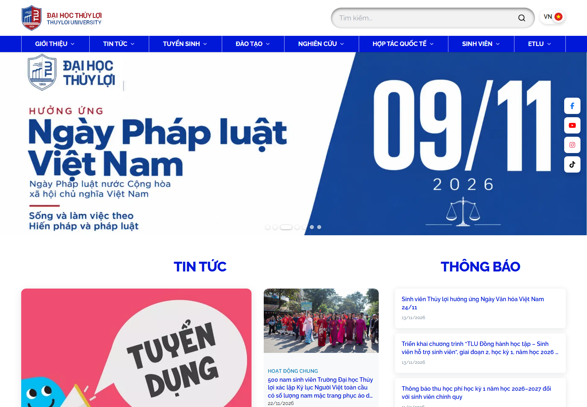
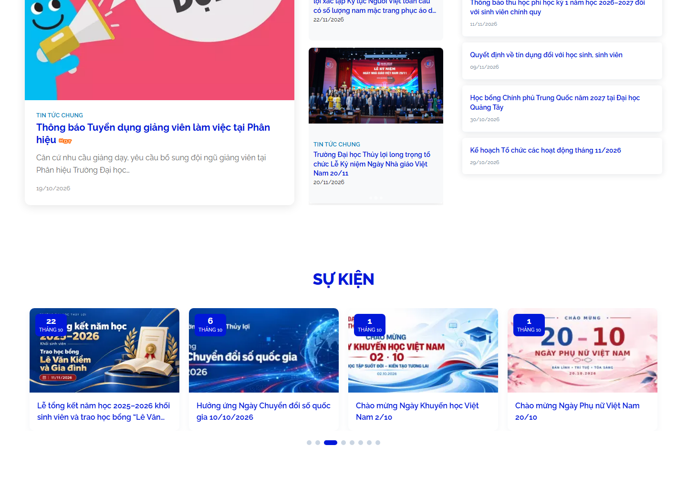
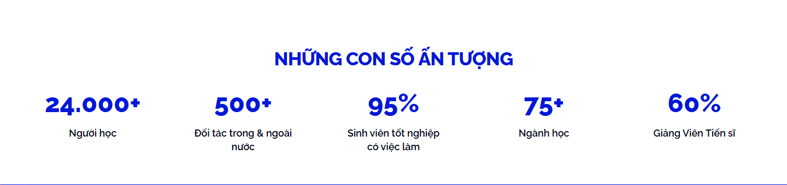
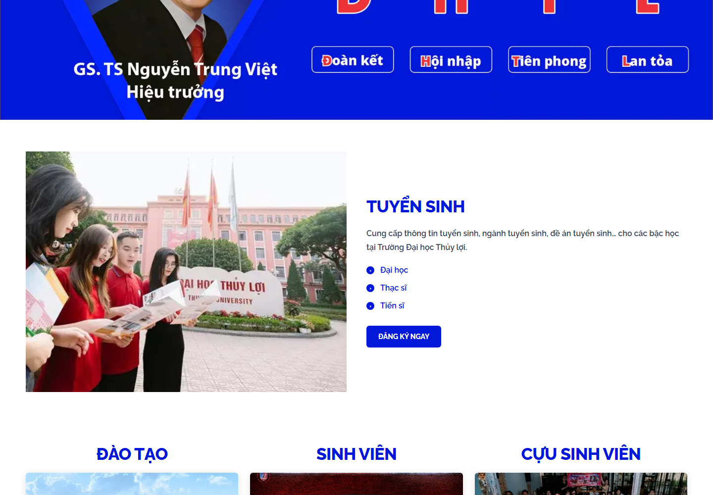
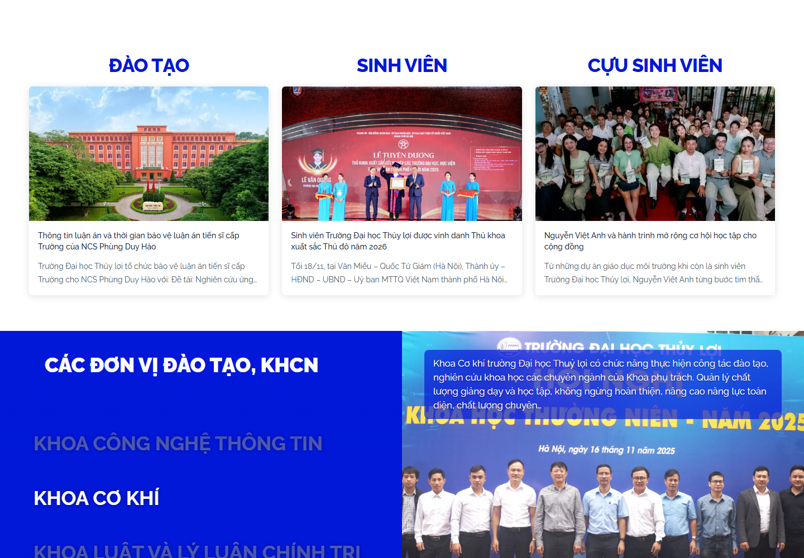
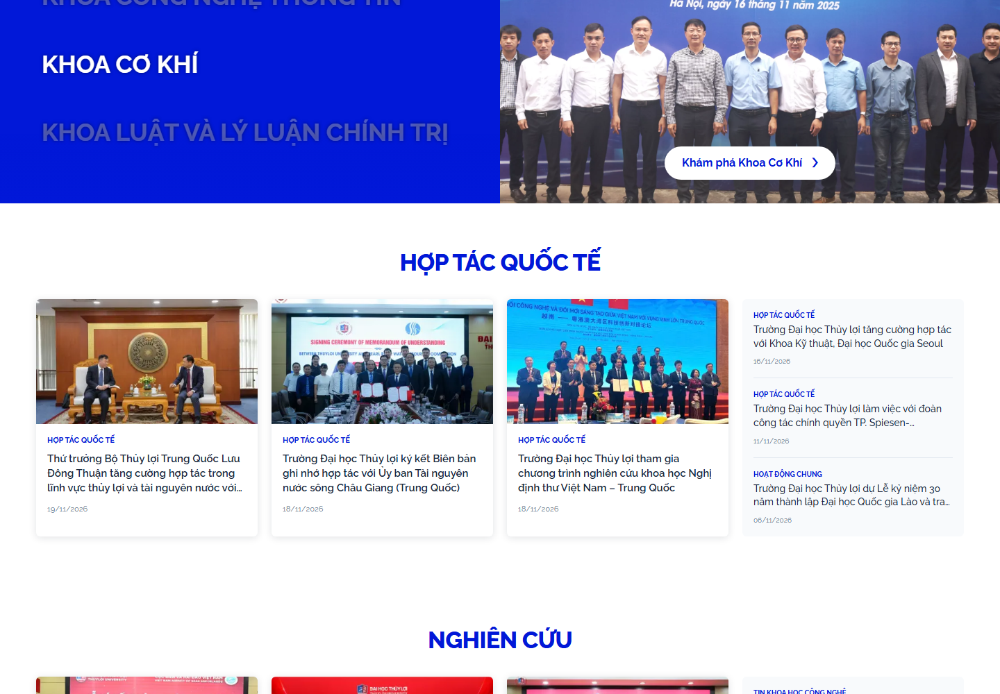
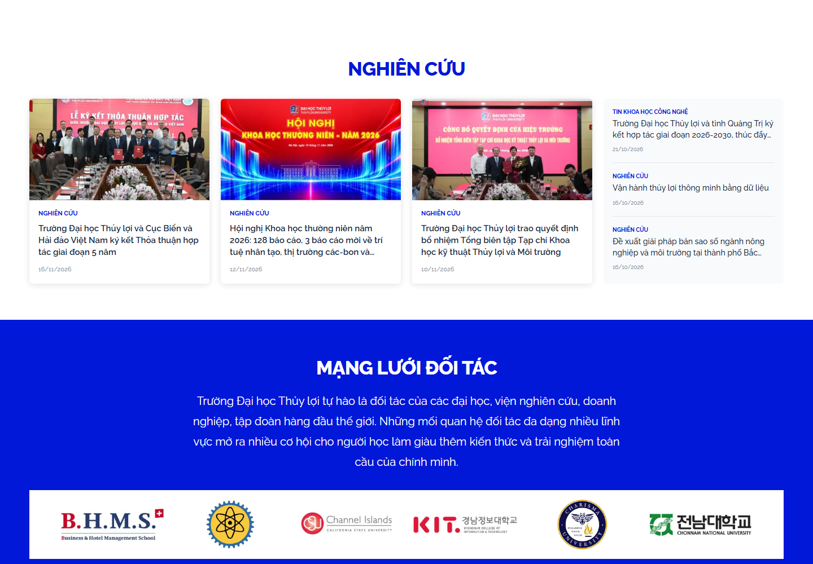
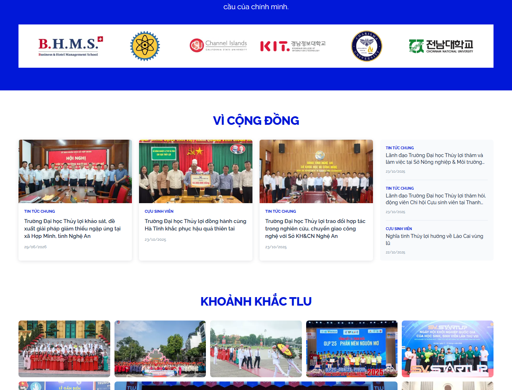
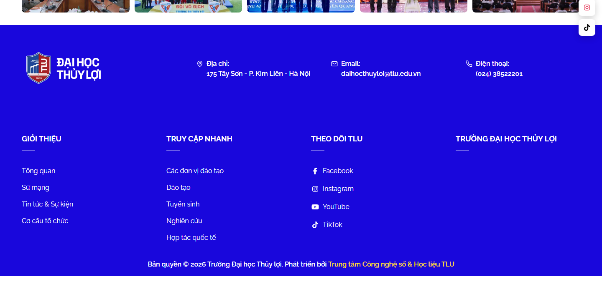

# PHÂN TÍCH BỐ CỤC WEBSITE TLU (tlu.edu.vn)
## Theo phương pháp 3 lớp song song: Layout Box → CSS Layout → Content + HTML

> **Đối tượng:** sinh viên mới học HTML/CSS layout.
> **Trang phân tích:** https://tlu.edu.vn/ (Trường Đại học Thủy lợi), ghi nhận ngày 25/11/2026.
> **Cách thu thập bằng chứng:** mở trang thật bằng trình duyệt, đo `getBoundingClientRect()` và `getComputedStyle()` ở viewport **1440×1000**, đọc DOM đã render, chụp ảnh từng vùng.
> Mọi con số kích thước dưới đây là **số đo thật**, không phải ước lượng.

---

## 0. CÁCH ĐỌC TÀI LIỆU NÀY

Mỗi component được phân tích đúng 3 lớp, không tách rời:

```text
A. LAYOUT BOX      → khoanh hộp, đặt tên, xác định cha – con
B. CSS LAYOUT      → Block / Flex / Grid / Position, container nào, item nào
C. CONTENT + HTML  → nội dung gì, thẻ semantic nào
```

Đi kèm là 2 phiên bản code: **chỉ dùng div** (để học dàn trang) và **semantic HTML** (để làm đúng chuẩn).

**Quy ước:**

- Tên class in trong code là **tên do tôi đề xuất theo vai trò** (`news-grid`, `notice-rail`…), không phải class gốc của website. Website thật dùng Tailwind (`grid lg:grid-cols-3`, `flex items-center`…). Tôi ghi class gốc trong ngoặc để bạn đối chiếu.
- Những gì **nhìn thấy/đo được** ghi là "đo được"; những gì **phải kiểm tra thêm** ghi rõ "cần xác nhận".

**Ảnh tham chiếu trong thư mục này:**

`desk-01-header-hero.png` · `desk-02-news.png` · `desk-03-news2-event.png` · `desk-04-stats-admissions.png` · `desk-05-training.png` · `desk-06-units-partners.png` · `desk-07-research-community.png` · `desk-08-moments-footer.png` · `desk-09-footer.png` · `desk-10-stats.png`

---

# 1. BẢN ĐỒ BỐ CỤC TOÀN TRANG

Đo ở 1440px: chiều cao toàn trang **7.962px**, vùng nội dung rộng **1.336px** (container `max-width:1400px` + padding 32px mỗi bên).

```text
page (body: flex column, min-height 100%)
│
├── header.site-header        sticky, cao 128px (88 + 40)
│   ├── header-bar            88px  → logo | search | ngôn ngữ
│   └── main-nav              40px  → 8 mục menu + dropdown tuyệt đối
│
├── main (flex: 1)
│   ├── section.hero             450px   slider ảnh toàn chiều rộng
│   ├── section.news              888px   Tin tức + Thông báo
│   ├── section.events            465px   Sự kiện (slider thẻ)
│   ├── section.stats             308px   Những con số ấn tượng (dl)
│   ├── section.banner            553px   Ảnh banner hiệu trưởng (tĩnh)
│   ├── section.admissions        614px   Tuyển sinh (2 cột)
│   ├── section.programs          537px   Đào tạo | Sinh viên | Cựu sinh viên
│   ├── section.units             500px   Các đơn vị đào tạo (2 nửa)
│   ├── section.partnerships      544px   Hợp tác quốc tế (3 thẻ + rail)
│   ├── section.research          530px   Nghiên cứu
│   ├── section.partner-network   489px   Mạng lưới đối tác (nền xanh)
│   ├── section.community         544px   Vì cộng đồng
│   ├── section.moments           811px   Khoảnh khắc TLU (mosaic)
│   │
│   └── nav.social-rail           fixed, cạnh phải, 4 icon
│
└── footer.site-footer           602px
    ├── footer-contact           logo + địa chỉ + email + điện thoại
    ├── footer-links             4 cột (3 cột link + 1 bản đồ)
    └── copyright
```

**Nhận xét tổng thể (quan trọng để học tư duy):**

Trang này là một chuỗi **section xếp dọc theo Normal Flow**. Việc "dàn trang" gần như chỉ nằm ở 2 tầng:

1. **Tầng trang:** các section chồng dọc — không cần Flex, không cần Grid.
2. **Tầng trong section:** container căn giữa (block + `margin-inline:auto`) và lưới bên trong (Flex hoặc Grid).

Toàn bộ trang chỉ có **3 kiểu lưới lặp lại**:

| Kiểu lưới | Nơi dùng | Kỹ thuật |
|---|---|---|
| 3 cột bằng nhau | Tin tức, 3 chương trình | Grid `repeat(3,1fr)` / `lg:grid-cols-3` |
| 4 cột: 3 thẻ + 1 rail | Hợp tác, Nghiên cứu, Cộng đồng | Grid `repeat(3,minmax(0,1fr)) minmax(230px,1fr)` |
| Mosaic ảnh | Khoảnh khắc TLU | Grid auto-rows + `col-span` / `row-span` |

Ngoài ra chỉ có 2 kiểu Flex điển hình: **hàng ngang căn giữa** (header, menu, nút) và **cột dọc căn giữa** (ô số liệu, drawer mobile).

---

# 2. KHUNG TRANG (PAGE SHELL)

### 1. Nhận diện Layout Box

```text
body
├── header.site-header     (sticky)
├── main                   (flex: 1)
└── footer.site-footer
```

- `body` là **Flex Container**, `flex-direction: column`, `min-height: 100%`.
- `header`, `main`, `footer` là **Flex Items**.
- `main` có `flex: 1` để đẩy footer xuống đáy khi nội dung ngắn (kỹ thuật **sticky footer**).

### 2. CSS layout

```css
body {
  display: flex;
  flex-direction: column;
  min-height: 100vh;
}
main { flex: 1; }
```

**Vì sao cần Flex ở đây?** Vì 3 khối này phải chia nhau chiều cao viewport. Nếu để Normal Flow, trang ngắn sẽ "hụt" và footer nằm lửng giữa màn hình.

### 3. Container căn giữa — dùng ở mọi section

Website dùng một container lặp lại: `mx-auto w-full max-w-[1400px] px-4 sm:px-6 lg:px-8`.

```css
.container {
  width: 100%;
  max-width: 1400px;
  margin-inline: auto;
  padding-inline: 32px;   /* 16 → 24 → 32 theo màn hình */
}
```

- **Không cần Flex/Grid**: container chỉ là khối block căn giữa bằng `margin: auto`.
- Đây là chỗ rất nhiều bạn sai: dùng `display:flex; justify-content:center` cho container → nội dung bị co lại theo nội dung thay vì chiếm hết chiều rộng.

### 6. CSS minh họa

```css
.page { min-height: 100vh; display: flex; flex-direction: column; }
.page-main { flex: 1; }

.container {
  width: 100%;
  max-width: 1400px;
  margin-inline: auto;
  padding-inline: 32px;
}
```

### 7. Kết luận tư duy

```text
page        → Flex column (sticky footer)
section     → Block, xếp dọc tự nhiên
container   → Block + max-width + margin auto
```

> **Bài học:** không phải chỗ nào cũng cần Flex. Chỉ 3 khối lớn của trang cần Flex để chia chiều cao.

---

# 3. COMPONENT 1 — HEADER BAR (logo + tìm kiếm + ngôn ngữ)



### 1. Nhận diện Layout Box

```text
header.site-header            sticky, nền trắng, shadow
└── header-bar                cao 88px
    └── container             flex, justify-between, items-center
        ├── brand             a > img (logo)   300×65
        └── header-actions    flex, gap 12px, margin-left:auto
            ├── search-form   form 500px (ẩn dưới 1025px)
            │   ├── label.sr-only
            │   ├── input[type=search]
            │   └── button[type=submit]   (icon kính lúp)
            └── lang-switch   VN + cờ
```

**Vì sao cần hộp riêng cho `header-actions`?** Vì nhóm tìm kiếm + ngôn ngữ phải dồn về bên phải, còn logo bám trái. Tách nhóm giúp `justify-content: space-between` chỉ việc đẩy 2 khối ra 2 đầu.

### 2. Tư duy dàn trang CSS

**Layout mode chính: Flexbox (1 chiều ngang).**

```text
Flex Container : .header-bar
Flex Items     : .brand, .header-actions

display: flex;
align-items: center;
justify-content: space-between;
gap: 8px;
```

- Logo: `flex: none` để không bị co (đo được `w-[300px]`).
- Nhóm phải: `margin-left: auto` + `display:flex; gap:12px`.

**Bên trong `search-form` lại là Position:**

```css
.search-form { position: relative; width: 500px; }
.search-form input { width: 100%; padding-right: 56px; }
.search-form button {
  position: absolute;
  right: 12px;
  top: 50%;
  transform: translateY(-50%);
}
```

- Mốc định vị (`position: relative`) là **form**, không phải trang.
- Nút kính lúp nằm **đè lên** input → bắt buộc dùng absolute; dùng Flex sẽ đẩy input ngắn lại và mất hiệu ứng "icon nằm trong ô".

> **Vì sao không dùng Flex cho ô tìm kiếm?** Vì icon phải nằm *trong* ô nhập, không phải cạnh ô nhập. Đây là khác biệt bản chất giữa "xếp cạnh nhau" (Flex) và "chồng lên nhau" (Position).

### 3. Nội dung bên trong

| Nội dung | Vai trò | HTML phù hợp |
|---|---|---|
| Logo trường | hình ảnh thương hiệu, bấm về trang chủ | `a` > `img alt="Trường Đại học Thủy lợi"` |
| Ô tìm kiếm | form tìm kiếm | `form[role=search]` > `label.sr-only` + `input[type=search]` + `button[type=submit]` |
| Ngôn ngữ | chuyển ngôn ngữ | `button` hoặc `select` + `img` cờ (**cần xác nhận** vì markup đang ẩn) |

### 4. Phiên bản chỉ dùng div

```html
<div class="header-bar">
  <div class="brand">
    
  </div>

  <div class="header-actions">
    <div class="search-form">
      <input type="search" placeholder="Tìm kiếm..." />
      <div class="search-btn">🔍</div>
    </div>
    <div class="lang-switch">VN</div>
  </div>
</div>
```

### 5. Phiên bản HTML Semantic

```html
<header class="site-header">
  <div class="header-bar container">

    <a class="brand" href="/">
      
    </a>

    <div class="header-actions">
      <form class="search-form" role="search" action="/tim-kiem">
        <label class="sr-only" for="q">Tìm kiếm</label>
        <input id="q" type="search" name="q" placeholder="Tìm kiếm..." />
        <button type="submit" aria-label="Tìm kiếm">
          <svg aria-hidden="true"><!-- icon --></svg>
        </button>
      </form>

      <button class="lang-switch" type="button" aria-label="Chọn ngôn ngữ">
        VN 
      </button>
    </div>

  </div>
</header>
```

### 6. CSS Layout minh họa

```css
.site-header {
  position: sticky;
  top: 0;
  z-index: 30;
  background: #fff;
  box-shadow: 0 1px 3px rgb(0 0 0 / .18);
}

.header-bar {
  display: flex;
  align-items: center;
  justify-content: space-between;
  gap: 8px;
  height: 88px;
}

.brand { flex: none; width: 300px; }
.brand img { width: 100%; height: 100%; object-fit: contain; object-position: left; }

.header-actions {
  margin-left: auto;
  display: flex;
  align-items: center;
  gap: 12px;
}
```

### 7. Kết luận tư duy

```text
header-bar
Layout: brand + actions (2 khối 2 đầu)
CSS   : Flex row, justify-between, items-center
Extra : search-form = relative + absolute button
HTML  : header, a, img, form, label, input, button
```

**Điểm đáng học:** `position: sticky` cho header — header dính khi cuộn nhưng vẫn chiếm chỗ trong luồng (khác `fixed`).

---

# 4. COMPONENT 2 — MAIN NAVIGATION + DROPDOWN

### 1. Nhận diện Layout Box

```text
nav.main-nav              nền #0118d8, cao 40px (ẩn < 1025px)
└── container             flex, height 100%
    └── ul.nav-list       flex, items-stretch, w-full
        └── li.nav-item   flex, flex-auto, border-right
            ├── a.nav-link          flex, canh giữa
            └── div.nav-dropdown    absolute, top:100%, w:288px
                └── ul[role=menu] > li > a
```

Đo được: 8 `li` rộng lần lượt **168 / 147 / 178 / 153 / 182 / 220 / 162 / 126px** → tổng vừa khít 1.336px. Đây là **`flex: 1 1 auto`** chia đều phần trống, không phải `width` cố định.

### 2. Tư duy dàn trang CSS

**Tầng 1 — menu ngang: Flexbox.**

```text
Flex Container : .nav-list (ul)
Flex Items     : .nav-item (li)

display: flex;
align-items: stretch;   /* li cao bằng thanh nav */
```

```text
Flex Container : .nav-link (a)  ← nested flex
Flex Items     : chữ + mũi tên
justify-content: center;
align-items: center;
gap: 6px;
```

Li dùng `flex: auto` (= `1 1 auto`) để **tự giãn lấp đầy** chiều ngang; nhờ vậy menu dài ngắn khác nhau vẫn phủ kín thanh xanh.

**Tầng 2 — dropdown: Position + transition (không dùng Flex).**

```css
.nav-item { position: relative; }
.nav-dropdown {
  position: absolute;
  top: 100%;
  left: 0;
  width: 288px;
  opacity: 0;
  visibility: hidden;
  transform: translateY(4px);
  transition: all .15s;
}
.nav-item:hover .nav-dropdown,
.nav-item:focus-within .nav-dropdown {
  opacity: 1;
  visibility: visible;
  transform: translateY(0);
}
```

- Mốc định vị là **`li`** (`position: relative`), nên mỗi dropdown bám đúng dưới mục menu của nó.
- `visibility` + `opacity` (thay vì `display:none`) để có animation mượt.
- `:focus-within` giúp bàn phím vẫn mở được menu — chi tiết accessibility đáng học.
- Đo được: dropdown có `role="menu"` và menu con lồng nhau (`group/sub`).

> **Có phải slider/carousel?** Không. Đây là menu dropdown thuần CSS hover. (Đã xác nhận qua class `invisible ... group-hover:visible`.)

### 3. Nội dung bên trong

| Nội dung | Vai trò | HTML phù hợp |
|---|---|---|
| Thanh menu | điều hướng chính | `nav` > `ul` > `li` > `a` |
| Mục có menu con | mở dropdown | `li` > `a` + `ul` con (hoặc `button[aria-expanded]`) |
| Mũi tên xuống | dấu hiệu có menu con | `svg aria-hidden="true"` |

### 4. Phiên bản chỉ dùng div

```html
<div class="main-nav">
  <div class="nav-list">
    <div class="nav-item">
      <div class="nav-link">GIỚI THIỆU ▾</div>
      <div class="nav-dropdown">
        <div class="nav-sub">Tổng quan</div>
        <div class="nav-sub">Sứ mạng</div>
      </div>
    </div>
    <div class="nav-item"><div class="nav-link">TIN TỨC ▾</div></div>
  </div>
</div>
```

### 5. Phiên bản HTML Semantic

```html
<nav class="main-nav" aria-label="Điều hướng chính">
  <div class="container">
    <ul class="nav-list">
      <li class="nav-item">
        <a class="nav-link" href="/gioi-thieu">
          GIỚI THIỆU
          <svg aria-hidden="true"><!-- chevron --></svg>
        </a>
        <div class="nav-dropdown">
          <ul role="menu">
            <li role="none"><a role="menuitem" href="/gioi-thieu/tong-quan">Tổng quan</a></li>
            <li role="none"><a role="menuitem" href="/gioi-thieu/su-mang">Sứ mạng</a></li>
          </ul>
        </div>
      </li>
      <li class="nav-item"><a class="nav-link" href="/tin-tuc">TIN TỨC</a></li>
    </ul>
  </div>
</nav>
```

### 6. CSS Layout minh họa

```css
.main-nav { height: 40px; background: #0118d8; position: relative; z-index: 10; }
.main-nav .container { display: flex; height: 100%; }

.nav-list { display: flex; width: 100%; align-items: stretch; }

.nav-item {
  position: relative;
  display: flex;
  flex: auto;
  border-right: 1px solid rgb(255 255 255 / .7);
}
.nav-item:first-child { border-left: 1px solid rgb(255 255 255 / .7); }

.nav-link {
  display: flex;
  align-items: center;
  justify-content: center;
  gap: 6px;
  width: 100%;
  height: 100%;
  padding-inline: 8px;
  white-space: nowrap;
  color: #fff;
}
```

### 7. Kết luận tư duy

```text
main-nav
Layout: ul → li → a, dropdown tuyệt đối dưới li
CSS   : Flex (ngang) + Position (dropdown)
HTML  : nav, ul, li, a, svg
```

> **Lỗi thường gặp:** dùng `justify-content: space-between` cho menu → các mục dính 2 đầu, ở giữa trống. Muốn "chia đều toàn thanh" thì dùng `flex: 1` / `flex: auto` trên item.

---

# 5. COMPONENT 3 — MOBILE DRAWER

### 1. Nhận diện Layout Box

```text
header
├── overlay.fixed inset-0      (nền mờ, bấm để đóng)
└── aside#mobile-nav.fixed     w:340px, max-w:90vw, full height
    ├── drawer-head            flex, justify-between (logo + nút X)
    ├── drawer-search
    ├── nav                    flex:1, overflow-y:auto
    └── drawer-foot
```

### 2. Tư duy dàn trang CSS

- **Layout ngoài:** `position: fixed; inset-block: 0; left: 0;` → panel trượt, không đẩy nội dung.
- **Layout trong:** `display: flex; flex-direction: column;` với `nav { flex: 1; overflow-y: auto; }` → header/footer của drawer đứng yên, chỉ phần menu cuộn.
- Overlay: `fixed; inset: 0; background: rgb(2 6 23 / .55)`.

```css
.drawer {
  position: fixed;
  inset-block: 0;
  left: 0;
  width: 340px;
  max-width: 90vw;
  display: flex;
  flex-direction: column;
  background: #fff;
  z-index: 50;
}
.drawer-nav { flex: 1; overflow-y: auto; }
```

> **Vì sao `flex:1` + `overflow-y:auto`?** Để menu dài không đẩy phần footer của drawer ra ngoài màn hình. Đây là pattern "app shell" kinh điển.

### 3–7. Tóm tắt

| Nội dung | HTML |
|---|---|
| Panel trượt | `aside` (hoặc `div` có `role="dialog"`) |
| Nút đóng | `button aria-label="Đóng menu"` |
| Menu | `nav` > `ul` > `li` > `a` |
| Overlay | `div` (trang trí, `aria-hidden`) |

```text
Layout: fixed panel + flex column
CSS   : Position fixed + Flex column + overflow
HTML  : aside, nav, button, ul/li/a
```

---

# 6. COMPONENT 4 — HERO SLIDER


### 1. Nhận diện Layout Box

```text
section.hero                     position: relative, overflow: hidden, cao 450px
└── .hero-viewport
    └── .hero-track               flex row (Swiper)
        ├── .hero-slide  (100% width)
        ├── .hero-slide
        └── ...
    └── .hero-pagination           absolute, bottom giữa
```

Đo được: mỗi slide rộng đúng **1.440px** = 100% viewport; track là `display:flex` nằm ngang, dịch bằng `transform: translateX()`.

### 2. Tư duy dàn trang CSS

**Slider = Flex row + overflow hidden + transform**, không phải Grid:

```css
.hero { position: relative; overflow: hidden; }
.hero-track { display: flex; transition: transform .4s; }
.hero-slide { flex: 0 0 100%; }      /* không co, không giãn */
```

- `flex: 0 0 100%` là công thức chuẩn cho slide: **không cho phép co** (`flex-shrink:0`) — nếu để mặc định, các slide sẽ bị bóp lại vừa khung.
- Dot điều hướng: `position: absolute; left:50%; bottom:16px; transform:translateX(-50%)` + flex `gap`.

> **Cần xác nhận:** đây là Swiper (thư viện JS). Về layout nó vẫn là Flex row; JS chỉ đổi `transform`. Không có mũi tên trái/phải trong ảnh — điều hướng bằng dot + auto-play.

### 3. Nội dung bên trong — và một lỗi thật của website

Toàn bộ chữ trong hero **nằm trong ảnh** (đo được `innerText` của section = rỗng). Hệ quả:

- Không có `h1`, không có text cho screen reader, không SEO được cho nội dung chính.
- Trang chủ hiện **không có thẻ `h1` nào** (kiểm tra DOM: `document.querySelectorAll('h1').length === 0`).

**Cách làm đúng:**

```html
<section class="hero" aria-label="Tin nổi bật">
  <div class="hero-track">
    <article class="hero-slide">
      
      <div class="hero-caption">
        <p class="hero-kicker">Hưởng ứng</p>
        <h1>Ngày Pháp luật Việt Nam 09/11/2026</h1>
        <p>Sống và làm việc theo Hiến pháp và pháp luật</p>
        <a href="/...">Xem chi tiết</a>
      </div>
    </article>
  </div>
</section>
```

| Nội dung | HTML |
|---|---|
| Ảnh nền slide | `img alt=""` (trang trí) hoặc `picture` |
| Tiêu đề chính | `h1` (đặt trên ảnh, không nướng vào ảnh) |
| Nút xem thêm | `a` |
| Dot | `button aria-label="Slide 3"` |

### 7. Kết luận tư duy

```text
hero
Layout: viewport (overflow hidden) + track (flex row) + slide (flex 0 0 100%)
CSS   : Flex + Position (dot) + Transform (JS điều khiển)
HTML  : section, article, img, h1, p, a, button
```

---

# 7. COMPONENT 5 — KHỐI TIN TỨC (featured + cột phụ + rail thông báo)



Đây là component **giàu bài học nhất** của trang: Grid lồng Grid.

### 1. Nhận diện Layout Box

```text
section.news
└── container
    └── .news-layout            GRID 3 cột bằng nhau, gap 40px
        ├── .news-main          grid-column: span 2   (đo được 877px)
        │   ├── h2.news-title   (thực tế là <a>)
        │   └── .news-split     GRID 2fr 1fr, gap 30px
        │       ├── article.featured-card
        │       └── .news-side  (slider dọc 2 thẻ nhỏ)
        └── aside.notice-rail   (đo được 419px)
            ├── h2.notice-title
            └── ul.notice-list  chia dòng bằng divide-y
                └── li > a + time
```

Đo được: 3 cột **418,66px** mỗi cột; cột trái chiếm 2 cột = 877px; chia tiếp 2fr : 1fr thành **~565px : ~282px**. Tỷ lệ **2 : 1** đúng như ảnh.

### 2. Tư duy dàn trang CSS

**Tầng ngoài: Grid 3 cột — vì cần "2 cột + 1 cột" chia theo đường cột chung.**

```css
.news-layout {
  display: grid;
  grid-template-columns: repeat(3, minmax(0, 1fr));
  gap: 40px;
}
.news-main { grid-column: span 2; }
```

**Tầng trong: Grid 2fr 1fr — vì tỷ lệ cố định, không phụ thuộc nội dung.**

```css
.news-split {
  display: grid;
  grid-template-columns: 2fr 1fr;
  gap: 30px;
}
```

> **Vì sao Grid mà không Flex?**
> Vì đây là lưới **2 chiều có ranh giới cột rõ ràng**: thẻ lớn và cột nhỏ phải thẳng hàng với rail bên phải. Grid khai báo được `grid-column: span 2` — Flex không có khái niệm "chiếm 2 cột" của lưới cha.
> Nếu chỉ có 2 hộp cạnh nhau đơn thuần, `flex: 2` / `flex: 1` cũng làm được. Nhưng ở đây **hộp trái phải khớp với lưới 3 cột bên ngoài**, nên Grid là lựa chọn đúng bản chất.

**Rail thông báo: KHÔNG cần Flex/Grid.**

```text
ul.notice-list
└── li  (xếp dọc theo Normal Flow)
    ├── a       tiêu đề
    └── time    ngày
```

```css
.notice-list > li + li { border-top: 1px solid #e2e8f0; }
```

Đo được: site dùng `divide-y divide-slate-100` — kỹ thuật kẻ dòng giữa các `li` mà không cần `:last-child` phức tạp.

### 3. Nội dung bên trong

| Nội dung | Vai trò | HTML phù hợp |
|---|---|---|
| "TIN TỨC" | tiêu đề khối (đồng thời là link tới chuyên mục) | `h2` > `a` |
| Thẻ tin lớn | bài viết độc lập | `article` |
| Ảnh | ảnh minh họa | `a` > `img` |
| Chuyên mục | nhãn phân loại | `p` / `span` (hoặc `a`) |
| Tiêu đề tin | tiêu đề bài | `h3` > `a` |
| Mô tả | tóm tắt | `p` |
| Ngày đăng | thời gian | `time[datetime]` |
| Rail thông báo | danh sách thông báo | `aside` > `ul` > `li` > `a` + `time` |

### 4. Phiên bản chỉ dùng div

```html
<div class="news-layout">

  <div class="news-main">
    <div class="news-title">TIN TỨC</div>

    <div class="news-split">
      <div class="featured-card">
        <div class="card-media"></div>
        <div class="card-body">
          <div class="card-cat">TIN TỨC CHUNG</div>
          <div class="card-title">Thông báo Tuyển dụng giảng viên…</div>
          <div class="card-desc">Căn cứ nhu cầu giảng dạy…</div>
          <div class="card-date">19/10/2026</div>
        </div>
      </div>

      <div class="news-side">
        <div class="mini-card">…</div>
        <div class="mini-card">…</div>
      </div>
    </div>
  </div>

  <div class="notice-rail">
    <div class="notice-title">THÔNG BÁO</div>
    <div class="notice-list">
      <div class="notice-item">…</div>
      <div class="notice-item">…</div>
    </div>
  </div>

</div>
```

### 5. Phiên bản HTML Semantic

```html
<section class="news" aria-labelledby="news-title">
  <div class="container">
    <div class="news-layout">

      <div class="news-main">
        <h2 class="news-title" id="news-title"><a href="/tin-tuc">TIN TỨC</a></h2>

        <div class="news-split">
          <article class="featured-card">
            <a class="card-media" href="/bai-viet" tabindex="-1" aria-hidden="true">
              
            </a>
            <div class="card-body">
              <p class="card-cat">Tin tức chung</p>
              <h3 class="card-title"><a href="/bai-viet">Thông báo Tuyển dụng giảng viên…</a></h3>
              <p class="card-desc">Căn cứ nhu cầu giảng dạy…</p>
              <time class="card-date" datetime="2026-10-19">19/10/2026</time>
            </div>
          </article>

          <div class="news-side">
            <article class="mini-card">…</article>
            <article class="mini-card">…</article>
          </div>
        </div>
      </div>

      <aside class="notice-rail" aria-labelledby="notice-title">
        <h2 class="notice-title" id="notice-title"><a href="/thong-bao">THÔNG BÁO</a></h2>
        <ul class="notice-list">
          <li>
            <a href="/thong-bao/1">Sinh viên Thủy lợi hưởng ứng Ngày Văn hóa Việt Nam 24/11</a>
            <time datetime="2026-11-13">13/11/2026</time>
          </li>
        </ul>
      </aside>

    </div>
  </div>
</section>
```

### 6. CSS Layout minh họa

```css
.news-layout {
  display: grid;
  grid-template-columns: repeat(3, minmax(0, 1fr));
  gap: 40px;
}

.news-main { grid-column: span 2; min-width: 0; }

.news-split {
  display: grid;
  grid-template-columns: 2fr 1fr;   /* tỷ lệ 2 : 1 */
  gap: 30px;
}

/* Thẻ tin: Normal Flow, không cần Flex */
.featured-card { background: #fff; border-radius: 12px; overflow: hidden; }
.card-media { display: block; aspect-ratio: 5 / 4; }
.card-media img { width: 100%; height: 100%; object-fit: cover; }
.card-body { padding: 24px; }

/* Rail: Normal Flow + kẻ dòng */
.notice-list > li + li { border-top: 1px solid #e2e8f0; }
```

### 7. Kết luận tư duy

```text
news-layout
Layout: 3 cột, cột trái span 2; trong cột trái chia 2fr : 1fr
CSS   : Grid (lồng Grid)
HTML  : section, h2 > a, article, img, h3 > a, p, time, aside, ul/li
```

> **Điểm cần tránh:** website dùng **2 bản DOM** cho desktop (`max-md:hidden`) và mobile (`hidden max-md:block`). Cách này nhân đôi code và dễ lệch nội dung. Với người mới, hãy dùng **một** lưới + media query.

---

# 8. COMPONENT 6 — EVENT SLIDER + EVENT CARD


### 1. Nhận diện Layout Box

```text
section.events
└── container
    ├── h2.events-title          căn giữa
    └── .slider
        ├── .slider-viewport     overflow: hidden
        │   └── .slider-track    flex row, gap 16px
        │       └── article.event-card  (4 thẻ hiển thị)
        └── .slider-dots         flex, justify-center, gap 8px
```

### 2. Tư duy dàn trang CSS

- **Slider:** Flex row + `overflow:hidden`, thẻ `flex: 0 0 calc((100% - 3*gap)/4)` → hiện đúng 4 thẻ.
- **Trong thẻ:** Normal Flow (ảnh trên, chữ dưới), **không cần Flex**.
- **Badge ngày:** `position: absolute` so với ảnh.

```css
.event-card { position: relative; }
.event-card .card-media { aspect-ratio: 16 / 9; overflow: hidden; }
.event-date {
  position: absolute;
  left: 12px;
  top: 12px;
  display: flex;
  flex-direction: column;
  align-items: center;
}
```

Đo được: website dùng `<time datetime="2026-11-19...">` bọc 2 `span` (số ngày + "Tháng 11") — **đúng chuẩn semantic** và flex column để số nằm trên chữ.

### 3. Nội dung + HTML

| Nội dung | HTML |
|---|---|
| Khối | `section` + `h2` |
| Thẻ sự kiện | `article` |
| Ảnh + link | `a` > `img` |
| Badge ngày | `time[datetime]` > `span` + `span` |
| Tiêu đề | `h3` > `a` |
| Dot | `button` |

### 4–5. Hai phiên bản (rút gọn)

```html
<!-- div-only -->
<div class="event-card">
  <div class="card-media">
    <div class="event-date"><div>22</div><div>THÁNG 10</div></div>
  </div>
  <div class="card-title">Kỷ niệm Ngày Nhà giáo Việt Nam…</div>
</div>

<!-- semantic -->
<article class="event-card">
  <a class="card-media" href="/su-kien/1">
    
    <time class="event-date" datetime="2026-10-22">
      <span>22</span><span>Tháng 10</span>
    </time>
  </a>
  <h3><a href="/su-kien/1">Kỷ niệm Ngày Nhà giáo Việt Nam…</a></h3>
</article>
```

### 6. CSS

```css
.events .slider-track { display: flex; gap: 16px; }
.event-card { flex: 0 0 calc((100% - 48px) / 4); background: #fff; }
.event-card .card-media { position: relative; display: block; aspect-ratio: 16 / 9; }
```

### 7. Kết luận

```text
Layout: viewport + track + card
CSS   : Flex (track) + Position (badge)
HTML  : section, article, a, img, time, h3
```

---

# 9. COMPONENT 7 — "NHỮNG CON SỐ ẤN TƯỢNG" (dl + order)



### 1. Nhận diện Layout Box

```text
section#stats
└── container
    ├── h2
    └── dl.stats-grid               GRID: 2 cột → 5 cột
        └── div.stat (×5)            flex column, items-center
            ├── dt   nhãn ("Người học")     order: 2
            └── dd   số (24.000+)          order: 1
```

### 2. Tư duy dàn trang CSS

**Tầng ngoài: Grid** — số cột thay đổi theo màn hình, các ô bằng nhau.

```css
.stats-grid {
  display: grid;
  grid-template-columns: repeat(2, minmax(0, 1fr));
  gap: 36px 0;
  text-align: center;
}
@media (min-width: 850px) {
  .stats-grid { grid-template-columns: repeat(5, minmax(0, 1fr)); }
}
```

**Tầng trong: Flex column + `order` để đảo thứ tự hiển thị.**

```css
.stat { display: flex; flex-direction: column; align-items: center; }
.stat dt { order: 2; margin-top: 20px; }
.stat dd { order: 1; font-size: 48px; font-weight: 800; }
```

> **Vì sao `order` thay vì đặt số trước trong HTML?**
> Trong `dl`, thứ tự đúng về ngữ nghĩa là **`dt` (nhãn) rồi `dd` (giá trị)**. Đặt đúng DOM rồi dùng `order` để kéo số lên trên là cách "giữ ngữ nghĩa, đổi hình thức" — screen reader vẫn đọc "Người học: 24.000+".
> **Cạm bẫy:** `order` chỉ đổi thứ tự *thị giác*, không đổi thứ tự đọc. Chỉ dùng khi đảo thứ tự không làm sai nghĩa.

### 3. Nội dung + HTML

| Nội dung | Vai trò | HTML |
|---|---|---|
| Số liệu | cặp nhãn – giá trị | `dl` > `div` > `dt` + `dd` |
| Con số chạy | hiệu ứng đếm | `span` (JS cập nhật) |

### 4. Phiên bản chỉ dùng div

```html
<div class="stats-grid">
  <div class="stat">
    <div class="stat-num">24.000+</div>
    <div class="stat-label">Người học</div>
  </div>
</div>
```

### 5. Phiên bản semantic

```html
<section id="stats" aria-labelledby="stats-title">
  <div class="container">
    <h2 id="stats-title">NHỮNG CON SỐ ẤN TƯỢNG</h2>

    <dl class="stats-grid">
      <div class="stat">
        <dt>Người học</dt>
        <dd><span data-countup="24000">24.000+</span></dd>
      </div>
      <div class="stat">
        <dt>Đối tác trong &amp; ngoài nước</dt>
        <dd><span data-countup="500">500+</span></dd>
      </div>
    </dl>
  </div>
</section>
```

### 6. CSS

```css
.stats-grid { display: grid; grid-template-columns: repeat(2, minmax(0,1fr)); text-align: center; }
@media (min-width: 850px) { .stats-grid { grid-template-columns: repeat(5, minmax(0,1fr)); } }

.stat { display: flex; flex-direction: column; align-items: center; padding-inline: 20px; }
.stat dt { order: 2; margin-top: 20px; max-width: 190px; }
.stat dd { order: 1; margin: 0; font-size: 48px; font-weight: 800; }
```

### 7. Kết luận

```text
Layout: dl (grid) → div.stat (flex column)
CSS   : Grid (số cột) + Flex column + order
HTML  : section, h2, dl, dt, dd
```

---

# 10. COMPONENT 8 — TUYỂN SINH (2 cột ảnh – nội dung)



### 1. Nhận diện Layout Box

```text
section.admissions
└── container.grid             GRID 2 cột, items-center, gap 32/40px
    ├── .admission-media       ảnh, aspect-ratio 4/3
    └── .admission-body        block
        ├── h2.TUYỂN SINH
        ├── p.mô tả
        ├── ul.program-list    "› Đại học / Thạc sĩ / Tiến sĩ"
        └── div > a.cta        "ĐĂNG KÝ NGAY"
```

### 2. Tư duy dàn trang CSS

```css
.admissions-grid {
  display: grid;
  grid-template-columns: repeat(2, minmax(0, 1fr));
  gap: 40px;
  align-items: center;   /* ảnh và khối chữ cân giữa theo trục dọc */
}
.admission-media { aspect-ratio: 4 / 3; overflow: hidden; }
.admission-media img { width: 100%; height: 100%; object-fit: cover; }
.program-list { display: grid; gap: 12px; }   /* hoặc block + margin */
```

- `align-items: center` là chi tiết đáng chú ý: cột chữ ngắn hơn ảnh nhưng vẫn cân giữa.
- Danh sách 3 bậc học: **không cần Flex**, mỗi `li` là block, khoảng cách bằng `gap` của Grid hoặc `margin-bottom`.

**Về CTA "ĐĂNG KÝ NGAY":** đo được thẻ thật là `<a href="https://ts.tlu.edu.vn/">`. Đúng — vì nó **điều hướng** sang site tuyển sinh. Nếu chỉ mở modal thì mới dùng `button`.

### 3. Nội dung + HTML

| Nội dung | HTML |
|---|---|
| Tiêu đề khối | `h2` |
| Đoạn mô tả | `p` |
| Danh sách bậc học | `ul` > `li` > `a` (nếu bấm được) hoặc `li` |
| Nút điều hướng | `a` (không phải `button`) |
| Ảnh | `img` (nội dung) |

### 5. Phiên bản semantic

```html
<section class="admissions">
  <div class="container admissions-grid">

    <figure class="admission-media">
      
    </figure>

    <div class="admission-body">
      <h2>TUYỂN SINH</h2>
      <p>Cung cấp thông tin tuyển sinh, ngành tuyển sinh, đề án tuyển sinh… cho các bậc học tại Trường Đại học Thủy lợi.</p>

      <ul class="program-list">
        <li><a href="/tuyen-sinh/dai-hoc">Đại học</a></li>
        <li><a href="/tuyen-sinh/thac-si">Thạc sĩ</a></li>
        <li><a href="/tuyen-sinh/tien-si">Tiến sĩ</a></li>
      </ul>

      <a class="cta" href="https://ts.tlu.edu.vn/">Đăng ký ngay</a>
    </div>

  </div>
</section>
```

### 7. Kết luận

```text
Layout: 2 cột ảnh | nội dung
CSS   : Grid 2 cols + items-center
HTML  : section, figure, img, h2, p, ul/li/a, a.cta
```

---

# 11. COMPONENT 9 — BA CỘT CHƯƠNG TRÌNH (Đào tạo / Sinh viên / Cựu sinh viên)



### 1. Nhận diện Layout Box

```text
section.programs
└── container.grid           GRID 3 cột, gap 24px
    ├── .program-col
    │   ├── h3 (tiêu đề cột, căn giữa)
    │   └── article.program-card
    │       ├── a > img
    │       └── .card-body > h4/a + p
    ├── .program-col
    └── .program-col
```

### 2. Tư duy dàn trang CSS

```css
.programs-grid {
  display: grid;
  grid-template-columns: repeat(3, minmax(0, 1fr));
  gap: 24px;
}
.program-card img { aspect-ratio: 16 / 10; width: 100%; object-fit: cover; }
```

- **Grid vì 3 cột bằng nhau, cùng hàng.**
- Mỗi cột là Normal Flow: tiêu đề → ảnh → chữ → mô tả. **Không cần Flex.**
- Đo được: 3 cột **429,3px**, ảnh cao 248px.

> **Vì sao tiêu đề nằm ngoài `article`?** Vì "ĐÀO TẠO" là tiêu đề **cả cột**, không phải tiêu đề bài viết. Nếu đặt trong `article`, mỗi thẻ sẽ có 2 cấp tiêu đề lộn xộn.

### 3–5. HTML

```html
<div class="programs-grid">
  <div class="program-col">
    <h3>ĐÀO TẠO</h3>
    <article class="program-card">
      <a href="/dao-tao/1"></a>
      <h4><a href="/dao-tao/1">Thông tin luận án và thời gian bảo vệ…</a></h4>
      <p>Trường Đại học Thủy lợi tổ chức bảo vệ luận án…</p>
    </article>
  </div>
  <!-- cột 2, cột 3 tương tự -->
</div>
```

### 7. Kết luận

```text
Layout: 3 cột, mỗi cột 1 heading + 1 card
CSS   : Grid 3 cols; trong cột là Normal Flow
HTML  : section, h3, article, a, img, h4, p
```

---

# 12. COMPONENT 10 — "CÁC ĐƠN VỊ ĐÀO TẠO, KHCN" (2 nửa + danh sách chạy)

 · 

### 1. Nhận diện Layout Box

```text
section.units                 FLEX row (2 nửa bằng nhau 720px)
├── .units-list               FLEX column
│   ├── h2
│   ├── .units-scroller       swiper-vertical, overflow hidden
│   │   └── .unit-name (×11)
│   ├── .gradient-top         absolute
│   └── .gradient-bottom      absolute
└── .units-preview            FLEX row
    ├── .preview-bg           ảnh phủ kín
    └── .preview-content      FLEX column, overlay tuyệt đối
        ├── p.mô tả
        └── a.button "Khám phá Khoa Cơ Khí"
```

Đo được: mỗi nửa **720px**; danh sách 11 đơn vị (Khoa Công trình, Khoa Kỹ thuật Tài nguyên nước, Trung tâm Đào tạo Quốc tế…). Danh sách **tự chạy dọc** (Swiper vertical).

### 2. Tư duy dàn trang CSS

**Tầng ngoài: Flex row 2 nửa bằng nhau.**

```css
.units { display: flex; }
.units-list, .units-preview { flex: 1 1 0; min-width: 0; }
```

`flex: 1 1 0` (không phải `flex: 1` = `1 1 0%`) chia đúng 50/50 bất kể nội dung dài ngắn.

**Nửa trái: Flex column** để xếp tiêu đề + danh sách chạy.

**Nửa phải: Position** — ảnh nền phủ kín, khối chữ nằm trên.

```css
.units-preview { position: relative; }
.preview-bg { position: absolute; inset: 0; object-fit: cover; }
.preview-content {
  position: absolute;   /* hoặc relative + z-index */
  inset: 0;
  display: flex;
  flex-direction: column;
  justify-content: center;
  padding: 40px;
}
```

- Mốc định vị: `.units-preview`.
- Gradient trên/dưới của danh sách cũng là `absolute` — tạo hiệu ứng mờ dần khi chữ trôi qua.

> **Có khả năng** danh sách này là **marquee tự động + hover để xem trước**: rê chuột vào tên khoa thì nửa phải đổi ảnh/mô tả. Cần kiểm tra JS để xác nhận, nhưng lớp layout thì đã rõ.

### 3. Nội dung + HTML

| Nội dung | HTML |
|---|---|
| Tiêu đề khối | `h2` |
| Danh sách đơn vị | `ul` > `li` > `a`/`button` |
| Ảnh xem trước | `img` |
| Mô tả | `p` |
| Nút khám phá | `a` (điều hướng) |

### 5. Phiên bản semantic

```html
<section class="units">
  <div class="units-list">
    <h2>CÁC ĐƠN VỊ ĐÀO TẠO, KHCN</h2>
    <ul class="units-scroller">
      <li><a href="/khoa-cong-trinh">KHOA CÔNG TRÌNH</a></li>
      <li><a href="/khoa-kt-tnn">KHOA KỸ THUẬT TÀI NGUYÊN NƯỚC</a></li>
      <!-- ... -->
    </ul>
  </div>

  <div class="units-preview">
    
    <div class="preview-content">
      <p>Khoa Cơ khí trường Đại học Thủy lợi có chức năng thực hiện công tác đào tạo…</p>
      <a class="button" href="/khoa-co-khi">Khám phá Khoa Cơ Khí</a>
    </div>
  </div>
</section>
```

### 6. CSS

```css
.units { display: flex; }
.units-list { flex: 1 1 0; min-width: 0; display: flex; flex-direction: column; padding: 40px; }
.units-preview { flex: 1 1 0; min-width: 0; position: relative; overflow: hidden; }
.preview-bg { position: absolute; inset: 0; width: 100%; height: 100%; object-fit: cover; }
.preview-content { position: relative; display: flex; flex-direction: column; justify-content: center; gap: 20px; height: 100%; padding: 40px; }
```

### 7. Kết luận

```text
Layout: 2 nửa 50/50
CSS   : Flex row (ngoài) + Flex column (trong) + Position (overlay ảnh)
HTML  : section, h2, ul/li/a, img, p, a
```

---

# 13. COMPONENT 11 — "3 THẺ + RAIL" (Hợp tác quốc tế / Nghiên cứu / Vì cộng đồng)

 · 

Ba section này dùng **cùng một khuôn**. Học một lần, áp cho cả ba.

### 1. Nhận diện Layout Box

```text
section.news-rail
└── container
    ├── h2 (căn giữa)
    └── .rail-grid        GRID 4 cột: 3 thẻ + 1 rail
        ├── article.card (×3)
        └── .rail-panel   danh sách tin phụ (divide-y)
```

Class gốc đo được: `grid-cols-[repeat(3,minmax(0,1fr))_minmax(230px,1fr)] gap-5` → 3 cột **319px** + rail **319px** (tổng 1.336px, gap 20px).

### 2. Tư duy dàn trang CSS

```css
.rail-grid {
  display: grid;
  grid-template-columns: repeat(3, minmax(0, 1fr)) minmax(230px, 1fr);
  gap: 20px;
}
```

**Vì sao `minmax(0, 1fr)` chứ không phải `1fr`?** Vì `1fr` mặc định có `min-width: auto`: nếu trong thẻ có chữ/ảnh dài, cột sẽ **nở ra** và phá vỡ lưới. `minmax(0,1fr)` khoá mức tối thiểu về 0 → cột chia đều tuyệt đối. Đây là **lỗi kinh điển** khi làm card grid.

**Vì sao `minmax(230px, 1fr)` cho rail?** Để rail không bị bóp nhỏ hơn 230px (giữ tiêu đề tin đọc được), nhưng vẫn giãn theo lưới.

### 3. Nội dung + HTML

| Nội dung | HTML |
|---|---|
| Thẻ tin | `article` > `a > img` + `p.chuyên mục` + `h3 > a` + `time` |
| Rail | `aside` > `h2` + `ul` > `li` > `a` + `time` |

### 5. Phiên bản semantic

```html
<section class="partnerships" aria-labelledby="htqt-title">
  <div class="container">
    <h2 id="htqt-title"><a href="/hop-tac-quoc-te">HỢP TÁC QUỐC TẾ</a></h2>

    <div class="rail-grid">

      <article class="card">
        <a class="card-media" href="/bai-viet" tabindex="-1" aria-hidden="true">
          
        </a>
        <p class="card-cat">Hợp tác quốc tế</p>
        <h3><a href="/bai-viet">Thứ trưởng Bộ Thủy lợi Trung Quốc…</a></h3>
        <time datetime="2026-11-19">19/11/2026</time>
      </article>

      <aside class="rail-panel">
        <ul>
          <li>
            <p class="rail-cat">Hợp tác quốc tế</p>
            <a href="/bai-viet-2">Trường Đại học Thủy lợi tăng cường hợp tác…</a>
            <time datetime="2026-11-16">16/11/2026</time>
          </li>
        </ul>
      </aside>

    </div>
  </div>
</section>
```

### 6. CSS

```css
.rail-grid {
  display: grid;
  grid-template-columns: repeat(3, minmax(0, 1fr)) minmax(230px, 1fr);
  gap: 20px;
}
.card { background: #fff; border-radius: 6px; overflow: hidden; box-shadow: 0 2px 12px rgb(15 23 42 / .12); }
.card img { width: 100%; aspect-ratio: 16 / 9; object-fit: cover; }

.rail-panel { background: #f8fafc; border-radius: 6px; padding-inline: 16px; }
.rail-panel li + li { border-top: 1px solid #e2e8f0; }
```

### 7. Kết luận

```text
Layout: 1 lưới 4 cột (3 + 1)
CSS   : Grid với minmax(0,1fr) + rail min 230px
HTML  : section, h2 > a, article, aside, time
```

---

# 14. COMPONENT 12 — MẠNG LƯỚI ĐỐI TÁC (logo strip)


### 1. Nhận diện Layout Box

```text
section.partner-network       nền xanh, chữ trắng, căn giữa
└── container
    ├── h2
    ├── p (max-width 768px, margin auto)
    └── .logo-strip           nền trắng, padding, overflow hidden
        └── .logo-track       flex row (Swiper virtual)
            └── .logo-item    (img)
```

### 2. Tư duy dàn trang CSS

```css
.partner-network { text-align: center; }
.partner-network p { max-width: 768px; margin-inline: auto; }

.logo-strip { background: #fff; padding: 16px 48px; overflow: hidden; }
.logo-track { display: flex; align-items: center; gap: 64px; }
.logo-item { flex: 0 0 auto; }
.logo-item img { height: 56px; object-fit: contain; }
```

- Đoạn mô tả dùng `max-width` + `margin:auto` — **không cần Flex** để căn giữa khối chữ.
- Strip là **Flex row** vì các logo xếp ngang, cùng trục giữa. Đây là chỗ Flex hợp hơn Grid: số logo thay đổi, không cần cột đều.
- Logo là `` với `height` cố định + `object-fit: contain` để các logo tỷ lệ khác nhau vẫn cao bằng nhau.

### 7. Kết luận

```text
Layout: heading + đoạn + dải logo
CSS   : Block (heading/p) + Flex row (logo track)
HTML  : section, h2, p, div, ul/li, img
```

---

# 15. COMPONENT 13 — KHOẢNH KHẮC TLU (mosaic ảnh)



### 1. Nhận diện Layout Box

```text
section.moments
└── container
    ├── h2
    └── .moment-grid        GRID: 3 → 4 → 5 cột, auto-rows 100/120/160px
        ├── button.moment (×14)   mỗi ô 257×160
        └── button.moment.featured  col-span 3, row-span 2 → 797×332
```

Đo được: **5 cột × 257,6px**, hàng cao **160px**, gap 12px; ô lớn chiếm **3 cột × 2 hàng** = 797×332. Tổng **15 ô**.

### 2. Tư duy dàn trang CSS

```css
.moment-grid {
  display: grid;
  grid-template-columns: repeat(3, minmax(0, 1fr));
  grid-auto-rows: 100px;
  gap: 12px;
}
@media (min-width: 768px) {
  .moment-grid { grid-template-columns: repeat(4, minmax(0, 1fr)); grid-auto-rows: 120px; }
  .moment.featured { grid-column: span 3; grid-row: span 2; }
}
@media (min-width: 1024px) {
  .moment-grid { grid-template-columns: repeat(5, minmax(0, 1fr)); grid-auto-rows: 160px; }
  .moment.featured { grid-row: span 3; }
}
```

**Vì sao Grid là bắt buộc ở đây?** Vì cần ô lớn **chiếm nhiều cột và nhiều hàng cùng lúc**. Flexbox không có khái niệm `grid-column: span 3` — muốn làm bằng Flex phải chia hàng thủ công, rất dễ vỡ.

Ô ảnh dùng `button` (đo được) → **hợp lý nếu bấm vào mở lightbox**. Nếu bấm để sang trang khác thì phải là `a`.

### 3–5. HTML

```html
<div class="moment-grid">
  <button class="moment" type="button" aria-label="Xem ảnh: Lễ tốt nghiệp 2026">
    
  </button>

  <button class="moment featured" type="button" aria-label="Xem ảnh: Khai giảng">
    
  </button>
</div>
```

### 6. CSS

```css
.moment { position: relative; overflow: hidden; border-radius: 8px; background: #f1f5f9; padding: 0; border: 0; }
.moment img { position: absolute; inset: 0; width: 100%; height: 100%; object-fit: cover; }
```

### 7. Kết luận

```text
Layout: mosaic 15 ô, 1 ô lớn
CSS   : Grid + auto-rows + span
HTML  : section, h2, button (lightbox) / a, img
```

---

# 16. COMPONENT 14 — FOOTER



### 1. Nhận diện Layout Box

```text
footer.site-footer              nền xanh đậm
└── container
    ├── .footer-contact         GRID: 1.35fr 1fr 1fr 1fr
    │   ├── .brand              logo
    │   ├── .contact-item       icon + (nhãn + giá trị)
    │   ├── .contact-item       Email
    │   └── .contact-item       Điện thoại
    ├── .footer-links           GRID 4 cột
    │   ├── section > h3 + ul (Giới thiệu)
    │   ├── section > h3 + ul (Truy cập nhanh)
    │   ├── section > h3 + ul (Theo dõi TLU)
    │   └── section > h3 + iframe (Bản đồ)
    └── p.copyright
```

Đo được: hàng 1 cột **369,9 / 274 / 274 / 274**; hàng 2 bốn cột **298px**; gap 48–64px.

### 2. Tư duy dàn trang CSS

**Grid cho cả 2 hàng** vì đều là lưới cột rõ ràng, cần thẳng hàng.

```css
.footer-contact {
  display: grid;
  grid-template-columns: 1.35fr 1fr 1fr 1fr;
  gap: 32px 48px;
  align-items: center;
}
.footer-links {
  display: grid;
  grid-template-columns: repeat(4, minmax(0, 1fr));
  gap: 48px;
}
```

**Từng mục liên hệ: Flex row.**

```css
.contact-item { display: flex; align-items: flex-start; gap: 8px; }
.contact-item svg { flex-shrink: 0; margin-top: 4px; width: 16px; }
```

`flex-shrink: 0` cho icon để icon không bị bóp khi số điện thoại dài.

**Danh sách link: Normal Flow.** Đo được `ul` dùng `space-y-4` — mỗi `li` block, cách nhau bằng margin.

### 3. Nội dung + HTML

| Nội dung | HTML |
|---|---|
| Logo | `img` |
| Địa chỉ | `address` (**đề xuất** — site đang dùng `div` + `p`) |
| Email/Điện thoại | `a href="mailto:…"` / `a href="tel:…"` |
| Cột link | `section` > `h3` + `ul` > `li` > `a` |
| Bản đồ | `iframe` (kèm `title`) |
| Bản quyền | `p` + `small` |

### 5. Phiên bản semantic

```html
<footer class="site-footer">
  <div class="container">

    <div class="footer-contact">
      <a class="brand" href="/"></a>

      <address class="contact-item">
        <svg aria-hidden="true"><!-- pin --></svg>
        <div>
          <p>Địa chỉ:</p>
          <p>175 Tây Sơn - P. Kim Liên - Hà Nội</p>
        </div>
      </address>

      <div class="contact-item">
        <svg aria-hidden="true"><!-- mail --></svg>
        <div>
          <p>Email:</p>
          <a href="mailto:daihocthuyloi@tlu.edu.vn">daihocthuyloi@tlu.edu.vn</a>
        </div>
      </div>

      <div class="contact-item">
        <svg aria-hidden="true"><!-- phone --></svg>
        <div>
          <p>Điện thoại:</p>
          <a href="tel:+842438522201">(024) 38522201</a>
        </div>
      </div>
    </div>

    <div class="footer-links">
      <section>
        <h3>GIỚI THIỆU</h3>
        <ul>
          <li><a href="/gioi-thieu/tong-quan">Tổng quan</a></li>
          <li><a href="/gioi-thieu/su-mang">Sứ mạng</a></li>
        </ul>
      </section>

      <section>
        <h3>TRUY CẬP NHANH</h3>
        <ul>
          <li><a href="/dao-tao">Đào tạo</a></li>
          <li><a href="/tuyen-sinh">Tuyển sinh</a></li>
        </ul>
      </section>

      <section>
        <h3>THEO DÕI TLU</h3>
        <ul>
          <li><a href="https://facebook.com/">Facebook</a></li>
          <li><a href="https://youtube.com/">YouTube</a></li>
        </ul>
      </section>

      <section>
        <h3>BẢN ĐỒ</h3>
        <iframe title="Bản đồ Trường Đại học Thủy lợi" src="…" loading="lazy"></iframe>
      </section>
    </div>

    <p class="copyright">
      <small>Bản quyền © 2026 Trường Đại học Thủy lợi.</small>
    </p>

  </div>
</footer>
```

### 6. CSS

```css
.footer-contact {
  display: grid;
  grid-template-columns: 1.35fr 1fr 1fr 1fr;
  gap: 32px 48px;
  align-items: center;
}
.footer-links { display: grid; grid-template-columns: repeat(4, minmax(0, 1fr)); gap: 48px; }
.contact-item { display: flex; align-items: flex-start; gap: 8px; }
.footer-links ul { display: flex; flex-direction: column; gap: 16px; }  /* hoặc block + margin */
```

### 7. Kết luận

```text
Layout: 2 hàng, mỗi hàng 4 cột
CSS   : Grid (hàng) + Flex row (mục liên hệ)
HTML  : footer, address, a[mailto/tel], section, h3, ul/li, iframe
```

> **Điểm đáng khen:** mỗi cột link là một `section` có `h3` — screen reader điều hướng theo tiêu đề rất tốt. Nhiều website bỏ qua chi tiết này.

---

# 17. COMPONENT 15 — SOCIAL RAIL (thanh icon cố định)

```text
nav.social-rail          position: fixed; right: 16px; top: 24vh
└── a (×4)               flex, 40×40, căn giữa icon
```

```css
.social-rail {
  position: fixed;
  right: 16px;
  top: 24vh;
  display: flex;
  flex-direction: column;
  gap: 8px;
  z-index: 20;
}
.social-rail a {
  display: flex;
  align-items: center;
  justify-content: center;
  width: 40px;
  height: 40px;
}
```

- `fixed` vì phải "dính" theo màn hình, không theo trang.
- `flex column` để xếp 4 icon dọc, `gap` đều.
- Mỗi link phải có `aria-label="Facebook"`… vì icon một mình không có text.

> Đo được: rail **ẩn dưới 768px** (`hidden md:flex`) — tránh che nội dung trên điện thoại.

---

# 18. BẢN ĐỒ FLEXBOX TOÀN TRANG

```text
PAGE
│
├── body                      [FLEX column]  ← sticky footer
│
├── HEADER
│   ├── header-bar            [FLEX row: space-between, center]
│   │   └── header-actions    [FLEX row, gap 12]
│   └── main-nav
│       ├── ul.nav-list       [FLEX row, stretch]
│       ├── li.nav-item       [FLEX row, flex:auto]
│       └── a.nav-link        [FLEX row, center]   ← nested flex
│
├── MOBILE DRAWER
│   ├── aside                 [FLEX column]
│   ├── drawer-head           [FLEX row, space-between]
│   └── drawer-nav            [FLEX 1 + overflow-y]
│
├── HERO
│   └── .hero-track           [FLEX row, nowrap]  ← slide 0 0 100%
│
├── STATS
│   └── .stat                 [FLEX column, items-center] ← order
│
├── UNITS
│   ├── section               [FLEX row]           ← 2 nửa 50/50
│   ├── .units-list           [FLEX column]
│   └── .preview-content      [FLEX column, center]
│
├── PARTNER STRIP
│   └── .logo-track           [FLEX row]
│
├── SLIDER DOTS               [FLEX row, justify-center, gap]
│
├── FOOTER
│   └── .contact-item         [FLEX row, items-start, gap]
│
└── SOCIAL RAIL               [FLEX column]
```

**Tổng hợp vai trò Flexbox trên trang:**

| Vai trò | Container | Item | Thuộc tính quyết định |
|---|---|---|---|
| Chia chiều cao trang | `body` | header/main/footer | `flex-direction: column`, `flex:1` |
| Căn 2 đầu | `.header-bar` | brand / actions | `justify-content: space-between` |
| Chia đều thanh menu | `.nav-list` | `.nav-item` | `flex: auto` |
| Căn giữa icon + chữ | `.nav-link`, `.btn` | chữ / icon | `align-items: center`, `gap` |
| Slider ngang | `.hero-track` | `.hero-slide` | `flex: 0 0 100%` |
| Đảo thứ tự nhãn/số | `.stat` | `dt` / `dd` | `order` |
| Chia đôi màn hình | `.units` | 2 nửa | `flex: 1 1 0` |
| Dãy logo | `.logo-track` | logo | `align-items: center` |
| Panel cuộn | drawer `nav` | — | `flex:1` + `overflow-y:auto` |
| Rail icon | `.social-rail` | `a` | `flex-direction: column` |

### NƠI KHÔNG CẦN FLEXBOX (rất quan trọng)

| Thành phần | Vì sao không cần |
|---|---|
| Các `section` xếp dọc | Normal Flow đã xếp dọc |
| Thẻ tin (`article`) | ảnh → chữ vốn xếp dọc |
| Rail thông báo (`ul > li`) | danh sách xếp dọc tự nhiên |
| `.program-col` | block tự xếp dọc |
| Danh sách link footer | `ul > li` block |
| `.stats-grid`, `.news-layout`, `.rail-grid`, `.moment-grid` | **Grid** phù hợp hơn |

> Nếu bạn thấy mình viết `display:flex; flex-direction:column` cho một khối chỉ có 3 phần tử xếp dọc bình thường → hãy bỏ đi. Đó là dấu hiệu "flex hóa mọi thứ".

---

# 19. BẢN ĐỒ GRID TOÀN TRANG

```text
PAGE
│
├── NEWS
│   ├── .news-layout        [GRID 3 × 1fr]  ← trái span 2
│   └── .news-split         [GRID 2fr 1fr]  ← GRID LỒNG GRID
│
├── STATS
│   └── dl.stats-grid       [GRID 2 → 5 cột]
│
├── ADMISSIONS
│   └── .admissions-grid    [GRID 2 cột, items-center]
│
├── PROGRAMS
│   └── .programs-grid      [GRID 3 cột]
│
├── PARTNERSHIPS / RESEARCH / COMMUNITY
│   └── .rail-grid          [GRID 3×1fr + minmax(230px,1fr)]
│
├── MOMENTS
│   └── .moment-grid        [GRID 3→4→5 cột, auto-rows, span 3×2]
│
└── FOOTER
    ├── .footer-contact     [GRID 1.35fr 1fr 1fr 1fr]
    └── .footer-links       [GRID 4 cột]
```

### Khi nào Grid thắng Flexbox?

| Tình huống | Chọn | Lý do |
|---|---|---|
| Các cột phải thẳng hàng với lưới cha (`span 2`) | Grid | Flex không có "cột" của cha |
| Ô ảnh chiếm nhiều hàng/cột | Grid | `row-span` / `col-span` |
| 5 ô số liệu bằng nhau, đổi số cột theo màn hình | Grid | `repeat(n, 1fr)` gọn hơn 5 `flex-basis` |
| 3 thẻ + 1 rail có bề rộng tối thiểu | Grid | `minmax(230px, 1fr)` |
| Dãy logo, số lượng thay đổi | Flex | Không cần cột đều |
| Hàng icon + chữ | Flex | Căn giữa theo trục phụ |

**Câu thần chú:** *một chiều → Flex, hai chiều → Grid.*

---

# 20. POSITION / STICKY / FIXED — BẢN ĐỒ

| Thành phần | Position | Mốc định vị | Vai trò |
|---|---|---|---|
| `header.site-header` | `sticky; top:0` | viewport | Dính khi cuộn, vẫn chiếm chỗ |
| `.nav-dropdown` | `absolute; top:100%` | `li.nav-item` | Menu con bám dưới mục |
| `.search-form button` | `absolute; right:12; top:50%` | `form` | Icon nằm trong ô nhập |
| `.hero-pagination` | `absolute; bottom:16` | `.hero` | Dot điều hướng |
| `.event-date` | `absolute; left:12; top:12` | `.card-media` | Badge ngày trên ảnh |
| `.units-preview img` | `absolute; inset:0` | `.units-preview` | Ảnh phủ kín |
| `.gradient-top/bottom` | `absolute` | `.units-list` | Hiệu ứng mờ |
| `.mobile-drawer` | `fixed; inset-block:0; left:0` | viewport | Panel trượt |
| `.overlay` | `fixed; inset:0` | viewport | Nền mờ |
| `.social-rail` | `fixed; right:16; top:24vh` | viewport | Icon luôn hiển thị |
| Ảnh `data-nimg="fill"` | `absolute; inset:0` | khung cha `relative` | Ảnh phủ khung |

**Nguyên tắc:** `absolute` **luôn** cần cha `relative` (hoặc `fixed/absolute/sticky`). Không có cha định vị → nó bám vào khối chứa ban đầu (thường là `body`) → lỗi rất hay gặp.

---

# 21. RESPONSIVE BEHAVIOR

Website dùng Tailwind với breakpoint: `sm 640`, `md 768`, `lg 1024`, và 2 breakpoint tùy biến đo được: **850px** (số liệu) và **1025px** (menu).

| Component | Desktop (≥1024) | Tablet (768–1023) | Mobile (<768) |
|---|---|---|---|
| Header | logo + search 500px + ngôn ngữ | ẩn search | logo + hamburger, drawer 340px |
| Main nav | thanh xanh 8 mục | **ẩn**, dùng drawer | ẩn, drawer |
| News | 3 cột, trái span 2, trong 2fr:1fr | 2 cột (trái chiếm cả hàng?) | 1 cột, ẩn split, hiện bản mobile riêng |
| Events | 4 thẻ/hàng | 2–3 thẻ | 1 thẻ |
| Stats | 5 cột (≥850) | 2 cột | 2 cột, ô đầu `col-span-2` |
| Admissions | 2 cột | 2 cột (md) | 1 cột |
| Programs | 3 cột | 3 cột (md) → 1 | 1 cột |
| 3 thẻ + rail | 4 cột | ẩn, bản mobile riêng | danh sách dọc |
| Units | 2 nửa ngang | 2 nửa | xếp dọc |
| Partner logo | 1 hàng ngang | 1 hàng | 1 hàng, ít logo hơn |
| Moments | 5 cột | 4 cột | 3 cột |
| Footer | 1.35fr + 3×1fr | 2 cột | 1 cột |
| Social rail | hiện | hiện (md) | ẩn |

**Code mẫu:**

```css
/* Container: padding theo màn hình */
.container { padding-inline: 16px; }
@media (min-width: 640px)  { .container { padding-inline: 24px; } }
@media (min-width: 1024px) { .container { padding-inline: 32px; } }

/* Stats */
@media (min-width: 850px) { .stats-grid { grid-template-columns: repeat(5, 1fr); } }

/* News — cách gọn, MỘT DOM duy nhất */
.news-layout { display: grid; grid-template-columns: 1fr; gap: 40px; }
@media (min-width: 1024px) {
  .news-layout { grid-template-columns: repeat(3, minmax(0, 1fr)); }
  .news-main { grid-column: span 2; }
  .news-split { display: grid; grid-template-columns: 2fr 1fr; gap: 30px; }
}

/* Footer */
.footer-contact { grid-template-columns: 1fr; }
@media (min-width: 640px)  { .footer-contact { grid-template-columns: repeat(2, 1fr); } }
@media (min-width: 1024px) { .footer-contact { grid-template-columns: 1.35fr 1fr 1fr 1fr; } }
```

**Nguyên tắc vàng:** khi lưới đổi số cột, **chỉ đổi `grid-template-columns`**, không đổi HTML. Chỉ khi thứ tự nội dung thực sự khác nhau mới cần đổi DOM — và nên tránh vì phải bảo trì 2 bản.

---

# 22. DOM TREE TOÀN TRANG

## 22.1. DOM chỉ dùng div (bản để học layout)

```html
<div class="page">

  <div class="site-header">
    <div class="header-bar">
      <div class="brand"></div>
      <div class="header-actions">
        <div class="search-form"><input /><div class="search-btn">🔍</div></div>
        <div class="lang-switch">VN</div>
      </div>
    </div>
    <div class="main-nav">
      <div class="nav-list">
        <div class="nav-item"><div class="nav-link">GIỚI THIỆU</div></div>
        <div class="nav-item"><div class="nav-link">TIN TỨC</div></div>
      </div>
    </div>
  </div>

  <div class="page-main">

    <div class="hero">
      <div class="hero-track">
        <div class="hero-slide"></div>
      </div>
      <div class="hero-pagination"><div class="dot"></div></div>
    </div>

    <div class="section news">
      <div class="container">
        <div class="news-layout">
          <div class="news-main">
            <div class="news-title">TIN TỨC</div>
            <div class="news-split">
              <div class="featured-card">
                <div class="card-media"></div>
                <div class="card-body">
                  <div class="card-cat">TIN TỨC CHUNG</div>
                  <div class="card-title">…</div>
                  <div class="card-desc">…</div>
                  <div class="card-date">19/10/2026</div>
                </div>
              </div>
              <div class="news-side">
                <div class="mini-card">…</div>
                <div class="mini-card">…</div>
              </div>
            </div>
          </div>
          <div class="notice-rail">
            <div class="notice-title">THÔNG BÁO</div>
            <div class="notice-list">
              <div class="notice-item">…</div>
            </div>
          </div>
        </div>
      </div>
    </div>

    <div class="section stats">
      <div class="container">
        <div class="section-title">NHỮNG CON SỐ ẤN TƯỢNG</div>
        <div class="stats-grid">
          <div class="stat"><div class="stat-num">24.000+</div><div class="stat-label">Người học</div></div>
        </div>
      </div>
    </div>

    <div class="section programs">
      <div class="container">
        <div class="programs-grid">
          <div class="program-col">
            <div class="col-title">ĐÀO TẠO</div>
            <div class="program-card">…</div>
          </div>
        </div>
      </div>
    </div>

    <div class="section units">
      <div class="units-list">…</div>
      <div class="units-preview">…</div>
    </div>

    <div class="section moments">
      <div class="container">
        <div class="section-title">KHOẢNH KHẮC TLU</div>
        <div class="moment-grid">
          <div class="moment"></div>
        </div>
      </div>
    </div>

  </div>

  <div class="site-footer">
    <div class="container">
      <div class="footer-contact">…</div>
      <div class="footer-links">…</div>
      <div class="copyright">…</div>
    </div>
  </div>

</div>
```

## 22.2. DOM semantic HTML

```html
<body class="page">

  <header class="site-header">
    <div class="header-bar container">
      <a class="brand" href="/"></a>
      <div class="header-actions">
        <form class="search-form" role="search">
          <label class="sr-only" for="q">Tìm kiếm</label>
          <input id="q" type="search" />
          <button type="submit" aria-label="Tìm kiếm">🔍</button>
        </form>
        <button class="lang-switch" type="button">VN</button>
      </div>
    </div>

    <nav class="main-nav" aria-label="Điều hướng chính">
      <div class="container">
        <ul class="nav-list">
          <li class="nav-item"><a class="nav-link" href="/gioi-thieu">GIỚI THIỆU</a></li>
          <li class="nav-item"><a class="nav-link" href="/tin-tuc">TIN TỨC</a></li>
        </ul>
      </div>
    </nav>
  </header>

  <main class="page-main">

    <section class="hero" aria-label="Tin nổi bật">
      <div class="hero-track">
        <article class="hero-slide">
          
          <h1>Lễ kỷ niệm Ngày Nhà giáo Việt Nam 20/11</h1>
        </article>
      </div>
    </section>

    <section class="news" aria-labelledby="news-title">
      <div class="container">
        <div class="news-layout">
          <div class="news-main">
            <h2 id="news-title"><a href="/tin-tuc">TIN TỨC</a></h2>
            <div class="news-split">
              <article class="featured-card">
                <a class="card-media" href="/bai-viet" tabindex="-1" aria-hidden="true"></a>
                <div class="card-body">
                  <p class="card-cat">Tin tức chung</p>
                  <h3><a href="/bai-viet">…</a></h3>
                  <p class="card-desc">…</p>
                  <time datetime="2026-10-19">19/10/2026</time>
                </div>
              </article>
              <div class="news-side">…</div>
            </div>
          </div>

          <aside class="notice-rail" aria-labelledby="notice-title">
            <h2 id="notice-title"><a href="/thong-bao">THÔNG BÁO</a></h2>
            <ul class="notice-list">
              <li><a href="/tb/1">…</a><time datetime="2026-11-13">13/11/2026</time></li>
            </ul>
          </aside>
        </div>
      </div>
    </section>

    <section id="stats" aria-labelledby="stats-title">
      <div class="container">
        <h2 id="stats-title">NHỮNG CON SỐ ẤN TƯỢNG</h2>
        <dl class="stats-grid">
          <div class="stat"><dt>Người học</dt><dd>24.000+</dd></div>
        </dl>
      </div>
    </section>

    <section class="programs" aria-labelledby="prog-title">
      <div class="container">
        <h2 class="sr-only" id="prog-title">Chương trình và cộng đồng</h2>
        <div class="programs-grid">
          <div class="program-col">
            <h3>ĐÀO TẠO</h3>
            <article class="program-card">
              <a href="/bai-viet"></a>
              <h4><a href="/bai-viet">…</a></h4>
              <p>…</p>
            </article>
          </div>
        </div>
      </div>
    </section>

    <section class="units" aria-labelledby="units-title">
      <div class="units-list">
        <h2 id="units-title">CÁC ĐƠN VỊ ĐÀO TẠO, KHCN</h2>
        <ul class="units-scroller">
          <li><a href="/khoa-cong-trinh">KHOA CÔNG TRÌNH</a></li>
        </ul>
      </div>
      <div class="units-preview">
        
        <div class="preview-content">
          <p>…</p>
          <a class="button" href="/khoa-co-khi">Khám phá Khoa Cơ Khí</a>
        </div>
      </div>
    </section>

    <section class="moments" aria-labelledby="moments-title">
      <div class="container">
        <h2 id="moments-title">KHOẢNH KHẮC TLU</h2>
        <div class="moment-grid">
          <button class="moment" type="button" aria-label="Xem ảnh"></button>
        </div>
      </div>
    </section>

  </main>

  <footer class="site-footer">
    <div class="container">
      <address class="footer-contact">…</address>
      <div class="footer-links">
        <section><h3>GIỚI THIỆU</h3><ul><li><a href="/">Tổng quan</a></li></ul></section>
      </div>
      <p class="copyright"><small>Bản quyền © 2026 Trường Đại học Thủy lợi.</small></p>
    </div>
  </footer>

</body>
```

---

# 23. BẢNG TỔNG HỢP TOÀN TRANG

| # | Component | Layout Box | Technique | Flex Container? | Flex Items | Nội dung | HTML semantic |
|---|---|---|---|---|---|---|---|
| 0 | Page shell | `body` | Flex column | Có | header, main, footer | Khung trang | `body`, `header`, `main`, `footer` |
| 1 | Header bar | `header-bar` | Flex row | Có | brand, actions | Logo, tìm kiếm, ngôn ngữ | `header`, `a`, `img`, `form`, `input`, `button` |
| 1b | Search box | `search-form` | Position | Không | — | Ô nhập + icon | `form[role=search]`, `label`, `input[type=search]`, `button` |
| 2 | Main nav | `nav-list` | Flex row | Có (nested) | `nav-item` | 8 mục menu | `nav`, `ul`, `li`, `a` |
| 2b | Dropdown | `nav-dropdown` | Position absolute | Không | — | Menu con | `ul[role=menu]`, `li`, `a` |
| 3 | Mobile drawer | `drawer` | Fixed + Flex column | Có | head, nav, foot | Menu mobile | `aside`, `nav`, `button` |
| 4 | Hero | `hero-track` | Flex row + Position | Có | `hero-slide` | Banner | `section`, `img`, `h1`, `a` |
| 5 | News block | `news-layout` | **Grid 3 → span 2** | Không | — | Tin tức | `section`, `h2 > a`, `article`, `time` |
| 5b | News split | `news-split` | **Grid 2fr 1fr** | Không | — | Tin lớn + tin nhỏ | `article`, `div` |
| 5c | Notice rail | `notice-list` | Normal Flow + `divide-y` | Không | — | Thông báo | `aside`, `ul`, `li`, `a`, `time` |
| 6 | Event card | `event-card` | Normal Flow + absolute badge | Không | — | Sự kiện | `article`, `a`, `img`, `time`, `h3` |
| 6b | Event slider | `slider-track` | Flex row + overflow | Có | 4 card | Slider | `section`, `article` |
| 7 | Stats | `stats-grid` | **Grid 2→5** | Không (trong ô có) | — | Số liệu | `section`, `dl`, `dt`, `dd` |
| 7b | Stat item | `stat` | Flex column + order | Có | dt, dd | Nhãn + số | `div` wrapper trong `dl` |
| 8 | Admissions | `admissions-grid` | **Grid 2 cột** | Không | — | Ảnh + nội dung | `section`, `figure`, `img`, `h2`, `ul`, `a` |
| 9 | Programs | `programs-grid` | **Grid 3 cột** | Không | — | 3 chuyên mục | `section`, `h3`, `article`, `h4` |
| 10 | Units | `units` | Flex row 50/50 + Position | Có | 2 nửa | Danh sách + preview | `section`, `h2`, `ul`, `img`, `a` |
| 11 | 3 cards + rail | `rail-grid` | **Grid 3 + minmax(230px)** | Không | — | Tin + thông báo | `section`, `article`, `aside`, `time` |
| 12 | Partner strip | `logo-track` | Flex row | Có | logo | Logo đối tác | `section`, `ul/li`, `img` |
| 13 | Moments | `moment-grid` | **Grid auto-rows + span** | Không | — | Ảnh | `section`, `button`, `img` |
| 14 | Footer | `footer-contact` / `footer-links` | **Grid 4 cột** | Không (trong mục con có) | — | Liên hệ + link | `footer`, `address`, `section`, `h3`, `ul`, `iframe` |
| 14b | Contact item | `contact-item` | Flex row | Có | icon, text | Địa chỉ/email/SĐT | `address`, `a[mailto]`, `a[tel]` |
| 15 | Social rail | `social-rail` | Fixed + Flex column | Có | 4 icon | Mạng xã hội | `nav`, `a`, `svg` |

---

# 24. CHECKLIST TƯ DUY CHO SINH VIÊN

```text
Nhìn thấy một vùng giao diện
        ↓
1. Khoanh hộp: vùng này gồm những khối nào?
        ↓
2. Đặt tên theo vai trò (news-card, notice-rail — không phải box1)
        ↓
3. Xác định cha – con: hộp nào chứa hộp nào?
        ↓
4. Các con cần đứng NGANG nhau?
        ├── Có → Flexbox (1 chiều)
        │        Container = ?
        │        Item = ?
        │        justify-content / align-items / gap ?
        └── Không
             ↓
5. Có cấu trúc HÀNG × CỘT, hoặc cần span?
        ├── Có → CSS Grid
        │        repeat(n, 1fr) hay tỷ lệ fr?
        │        có cần minmax(0,1fr)?
        └── Không → Normal Flow (block xếp dọc)
        ↓
6. Có phần tử chồng lên phần tử khác?
        ├── Có → Position (absolute + cha relative)
        └── Không → thôi
        ↓
7. Xác định kiểu nội dung từng hộp:
   tiêu đề? đoạn? link? nút? ảnh? danh sách? ngày?
        ↓
8. Chọn thẻ HTML semantic tương ứng
        ↓
9. Kiểm tra lại: có thẻ div nào "vô nghĩa" không cần thiết?
        ↓
10. Kiểm tra responsive: lưới đổi mấy cột? có phải đổi DOM không?
```

**Ba câu hỏi tự kiểm tra trước khi viết CSS:**

1. Hộp này là **một chiều** hay **hai chiều**? → Flex hay Grid.
2. Phần tử nào là **mốc định vị** cho `absolute`?
3. Nếu bỏ `display:flex` đi, layout có vỡ thật không? → nếu không, đừng dùng Flex.

---

# 25. NGUYÊN TẮC ĐẶT TÊN CLASS

**Tốt (theo vai trò):**

```text
site-header      header-bar       brand           search-form
main-nav         nav-list         nav-item        nav-dropdown
hero             hero-track       hero-slide      hero-pagination
news             news-layout      news-main       news-split
featured-card    notice-rail      notice-list
event-card       event-date
stats-grid       stat
admissions       admission-media  admission-body
programs-grid    program-col      program-card
units            units-list       units-preview
rail-grid        rail-panel
partner-network  logo-track       logo-item
moment-grid      moment
site-footer      footer-contact   footer-links
social-rail
```

**Không nên:**

```text
box1, box2, box3
left-area, right-area
big-box, small-box
blue-section, red-bg
container2, wrapper3
```

**Hệ thống nhất quán đang dùng trên trang (và nên giữ):**

```text
[thành phần]              news, hero, footer
[thành phần]-[phần]       news-main, hero-track, footer-links
[thành phần]-[phần]-[con] news-split, footer-contact
```

Ghi nhớ: tên class mô tả **vai trò trong bố cục**, không mô tả **hình thức** ("blue", "big", "left") và không đánh số.

---

# 26. CÁC LỖI TƯ DUY PHỔ BIẾN — VÀ BẰNG CHỨNG TỪ CHÍNH TRANG NÀY

| # | Lỗi | Biểu hiện | Cách sửa |
|---|---|---|---|
| 1 | **Flex hóa mọi thứ** | `.news-side` chỉ có 2 thẻ xếp dọc vẫn gắn `flex flex-col` | Chỉ dùng Flex khi cần phân bố theo trục; xếp dọc mặc định đã có |
| 2 | **Dùng `1fr` thay `minmax(0,1fr)`** | Lưới thẻ bị nở cột khi tiêu đề dài | `repeat(3, minmax(0,1fr))` + `min-width:0` cho item |
| 3 | **Lưới 2 chiều làm bằng Flex** | 3 thẻ + 1 rail: nếu dùng Flex phải set `flex-basis` thủ công, không span được | Chuyển sang Grid |
| 4 | **Nhân đôi DOM cho mobile** | TLU render 2 bản: `max-md:hidden` + `hidden max-md:block` cho cùng khối tin | Một DOM + media query đổi `grid-template-columns` |
| 5 | **Nội dung nằm trong ảnh** | Hero: chữ "Ngày Pháp luật Việt Nam" nằm trong file ảnh; `innerText` của section rỗng | Overlay text thật bằng `h1`/`p` trên ảnh |
| 6 | **Thiếu `h1`** | Trang chủ không có thẻ `h1` nào (đếm được = 0) | Đưa tiêu đề hero thành `h1` |
| 7 | **Tiêu đề khối chỉ là link** | "TIN TỨC", "THÔNG BÁO" là `<a>` trơn, không nằm trong `h2` | `h2 > a` |
| 8 | **Nút giả** | CTA "ĐĂNG KÝ NGAY" trông như button nhưng là `<a>` — **ở đây đúng** vì điều hướng | Quy tắc: điều hướng → `a`; thao tác tại chỗ → `button` |
| 9 | **Quên `flex-shrink:0` cho icon** | Icon footer bị bóp khi text dài | `svg { flex-shrink: 0; }` |
| 10 | **`absolute` không có cha `relative`** | Dropdown/kebab menu rơi về góc trang | Đặt `position: relative` cho item cha |
| 11 | **Dùng `order` bừa** | `order` đổi thị giác nhưng không đổi thứ tự đọc | Chỉ dùng khi nghĩa không đổi (như `dt/dd`) |
| 12 | **Container dùng Flex** | `display:flex; justify-content:center` cho container → nội dung co lại | `max-width` + `margin-inline:auto` |
| 13 | **Fixed che nội dung** | Rail icon, drawer không có `z-index`/khoảng đệm | `z-index` có hệ thống + padding cho nội dung |
| 14 | **Slider dùng `flex:1`** | Slide bị bóp nhỏ | `flex: 0 0 100%` |

---

# 27. BÀI TẬP LUYỆN (làm lại từ đầu, không copy site)

1. **Tái tạo Header + Nav** bằng một DOM duy nhất: logo trái, tìm kiếm phải (icon tuyệt đối trong ô), menu 8 mục chia đều, dropdown hover có animation, mobile < 1025px có drawer.
2. **Tái tạo khối Tin tức** với Grid lồng Grid: ngoài 3 cột (trái `span 2`), trong `2fr 1fr`, rail thông báo `ul > li + time`. Không được nhân đôi DOM cho mobile.
3. **Tái tạo Stats** bằng `dl > dt + dd`, dùng `order` để số nằm trên nhãn, 5 cột ≥850px, 2 cột ở mobile.
4. **Tái tạo "3 thẻ + rail"** với `grid-template-columns: repeat(3, minmax(0,1fr)) minmax(230px,1fr)`. Thử cố tình để tiêu đề rất dài để kiểm chứng `minmax(0,1fr)`.
5. **Tái tạo Mosaic 15 ảnh** với `grid-auto-rows`, một ô `col-span 3 / row-span 2`, đổi 3→4→5 cột theo breakpoint.

**Tiêu chí chấm:** mỗi component phải trả lời được 3 câu — *hộp nào? kỹ thuật gì? vì sao kỹ thuật đó?*

---

# 28. KẾT LUẬN NGẮN

Trang chủ TLU là ví dụ tốt để học vì nó **lặp lại vài khuôn layout rõ ràng** thay vì "mỗi section một kiểu":

- **Normal Flow** lo phần lớn công việc: section, article, danh sách.
- **Flexbox** xuất hiện ở những nơi thật sự cần phân bố 1 chiều: header, menu, slider, rail icon, panel cuộn.
- **Grid** xuất hiện ở những nơi cần lưới 2 chiều: tin tức (lồng 2 tầng), số liệu, 3 thẻ + rail, mosaic, footer.
- **Position** chỉ dùng cho 4 việc: header sticky, dropdown, badge/dot trên ảnh, panel cố định.

Điều đáng học nhất không phải là code Tailwind, mà là **cách phân tầng**:

```text
trang  → section (block, xếp dọc)
section→ container (max-width + margin auto)
container → lưới (Grid/Flex)
ô lưới → nội dung (Normal Flow + semantic HTML)
```

Đó chính là chuỗi tư duy: **nhìn giao diện → khoanh hộp → đặt tên → xác định cha/con → chọn Flex/Grid/Block/Position → xác định nội dung → chọn HTML semantic.**
